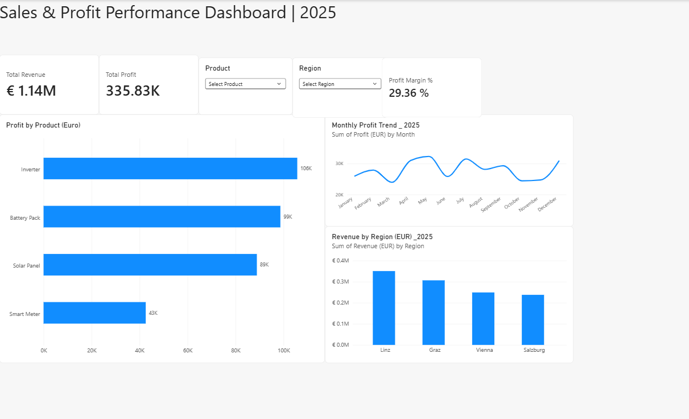

# Sales & Profit Performance Dashboard | Power BI
## Project Overview
This project presents an interactive sales and profitability dashboard created in Microsoft Power BI using a practice sales dataset.
The dashboard helps users explore revenue, profit, profit margins, product performance, regional sales, and monthly profit trends.
## Key Performance Indicators (KPIs)
- Total Revenue: €1.14M
- Total Profit: €335.83K
- Profit Margin: 29.36%
## Dashboard Features
- Profit comparison across four product categories
- Monthly profit trend analysis for 2025
- Revenue comparison across Austrian regions
- Interactive Product and Region slicers
- Dynamic KPIs that respond to selected filters
- Tooltips displaying additional financial information
## Tools and Skills
- Microsoft Power BI Desktop
- Data visualization and dashboard design
- KPI reporting
- Interactive filtering using slicers
- Sales and profitability analysis
## Key Insights
- Inverter generated the highest total profit among the four products.
- Smart Meter generated the lowest total profit.
- Monthly profitability fluctuated throughout 2025.
- Regional revenue analysis highlights differences in sales performance across locations.
## Dashboard Preview

## Project Purpose
- This project was developed as a hands-on portfolio exercise to strengthen practical skills in business reporting, financial analysis, and interactive dashboard development using Power BI.